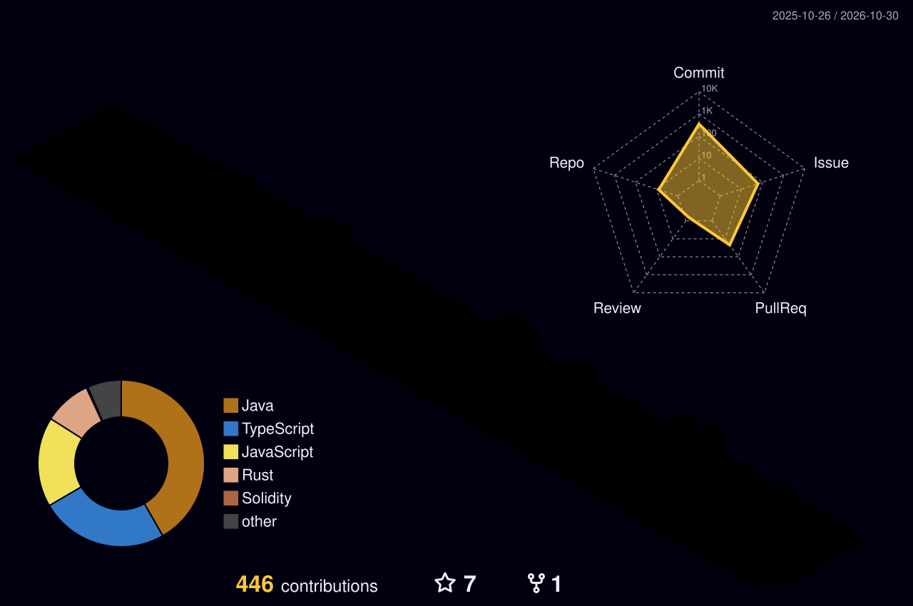

<!-- ░▒▓ NEON GRID · MiK@ ▓▒░ -->

<div align="center">


<a href="https://git.io/typing-svg">
  
</a>


</div>

```text
┌──[mik@neon-grid]─[~/profile]
└──╼ $ cat identity.json

{
  "handle":    "MiK@",
  "roles":     ["Blockchain developer", "Java developer"],
  "chain":     ["Solidity", "Hardhat", "Truffle"],
  "front":     ["React", "Next.js", "Angular"],
  "back":      ["Java", "Go", "Node.js"],
  "mission":   "Terra Aventura Radar 🔭",
  "status":    "ONLINE ▮"
}
```

<br />

## `> current_mission`

<table align="center">
  <tr>
    <td align="center" width="140">
      <a href="https://terra-aventura-radar.vercel.app/">
        
      </a>
    </td>
    <td>
      <b>🔭 Terra Aventura Radar</b><br />
      Le radar à Poï'z qui scanne le terrain de jeu.<br />
      <a href="https://terra-aventura-radar.vercel.app/">▶ Lancer le radar</a>
    </td>
  </tr>
</table>

<br />

## `> live_chain_feed`

<!-- Mis à jour automatiquement par .github/workflows/chain-stats.yml -->
<!--CHAIN:START-->
| ⛓️ Block | ⛽ Gas | 💎 ETH |
|:-:|:-:|:-:|
| `en attente…` | `en attente…` | `en attente…` |

<sub>⏱️ Premier scan bientôt…</sub>
<!--CHAIN:END-->

<br />

## `> arsenal`

<p align="center">
  &nbsp;&nbsp;
  &nbsp;&nbsp;
  &nbsp;&nbsp;
  &nbsp;&nbsp;
  &nbsp;&nbsp;
  &nbsp;&nbsp;
  &nbsp;&nbsp;
  &nbsp;&nbsp;
  &nbsp;&nbsp;
  &nbsp;&nbsp;
  &nbsp;&nbsp;
  &nbsp;&nbsp;
  
</p>

<br />

## `> trophies`

<p align="center">
  <a href="https://trophygithubreadmelang.cybee.dpdns.org">
    
  </a>
</p>

<br />

## `> system_stats`

<p align="center">
  <a href="https://github.com/Pranesh-2005/github-readme-stats-fast">
    
  </a>
  &nbsp;
  <a href="https://github.com/Pranesh-2005/github-readme-stats-fast">
    
  </a>
</p>

<p align="center">
  <a href="https://github.com/Pranesh-2005/github-readme-stats-fast">
    
  </a>
</p>

<br />

## `> contribution_city`

<p align="center">
  
</p>

<br />

## `> snake.exe`

<p align="center">
  
</p>

<br />

## `> open_channels`

<p align="center">
  <a href="https://www.linkedin.com/in/mickael-blondeau-952b4817/"></a>
  &nbsp;
  <a href="https://mickael-blondeau.vercel.app/"></a>
  &nbsp;
  
</p>


<!-- ### [](https://git.io/typing-svg)

 🔭 I’m currently working on [Terra Aventura Radar](https://terra-aventura-radar.vercel.app/) !


[](https://trophygithubreadmelang.cybee.dpdns.org)

### Languages and tools
&nbsp;
&nbsp;
&nbsp;
&nbsp;
&nbsp;
&nbsp;
&nbsp;
&nbsp;
&nbsp;
&nbsp;
&nbsp;
&nbsp;
&nbsp;

### Top languages
[](https://github.com/Pranesh-2005/github-readme-stats-fast)

### :fire: My stats :  
[](https://github.com/Pranesh-2005/github-readme-stats-fast)  
[](https://github.com/Pranesh-2005/github-readme-stats-fast)  

<p align="center">
  
  &nbsp;&nbsp;&nbsp;
  <a href="https://www.linkedin.com/in/mickael-blondeau-952b4817/"></a>
  &nbsp;&nbsp;&nbsp;
  <a href="https://mickael-blondeau.vercel.app/"></a>
</p> -->

<!-- 
### :fire: My stats : 
[](https://git.io/streak-stats)
-->

<!--
**mickablondo/mickablondo** is a ✨ _special_ ✨ repository because its `README.md` (this file) appears on your GitHub profile.

Here are some ideas to get you started:

- 🔭 I’m currently working on ...
- 🌱 I’m currently learning ...
- 👯 I’m looking to collaborate on ...
- 🤔 I’m looking for help with ...
- 💬 Ask me about ...
- 📫 How to reach me: ...
- 😄 Pronouns: ...
- ⚡ Fun fact: ...
-->
